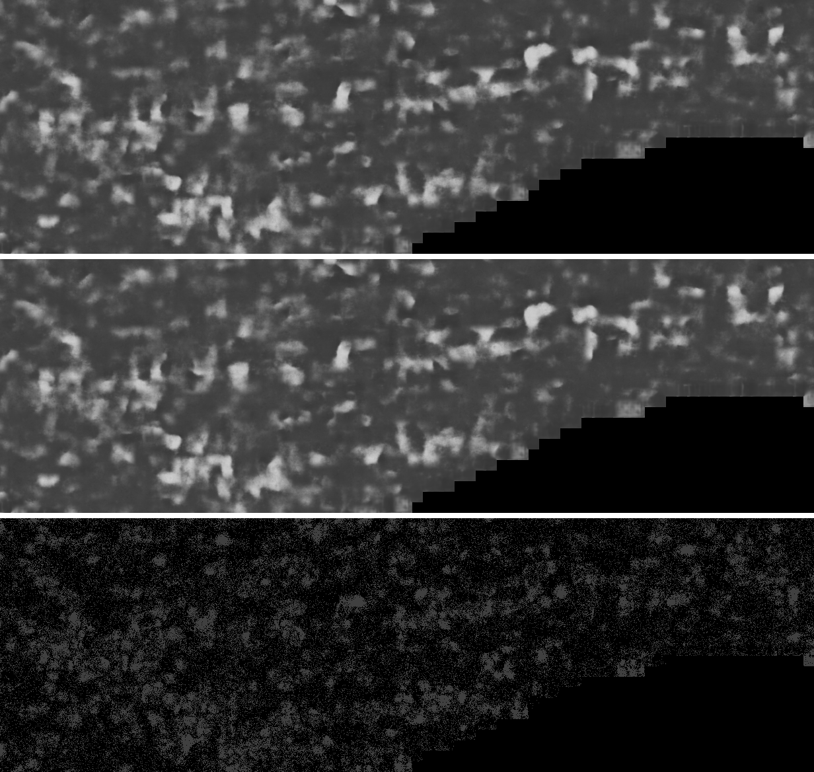

# inkrs

Fast native inference for the Vesuvius Challenge's models, written in Rust.

inkrs runs villa's models natively, entirely on the GPU: its ink readers and a handful of other ink models, and its nnU-Net surface model, `surface_m7_nnunet`. It writes the same outputs villa's Python code writes, just a lot faster: the volume and the model stay on the GPU, and one process runs every depth and both directions.

It runs on NVIDIA GPUs (compute capability 7.5 and up, so T4 / RTX 20 series and newer) and on Apple silicon Macs through Metal. The surface model and the 3D ink U-Net run on NVIDIA only, at compute capability 8.0 and up.

## How fast

All 18 maps of PHerc. 343's First Letters render with villa's `hybrid_3d2d-seed42`, on one RTX 5090:

| | Time | inkrs faster by |
|---|---|---|
| inkrs | **8.50 s** | |
| inksweep fast mode, with `torch.compile` | 64.5 s | **7.57×** |
| villa main with the faster flags from #2428 | 161.7 s | **19.0×** |

The other villa readers get a similar speedup, and inkrs is about 2.4× faster than UFSM, the closest native port. Hecate and v8-in gain less (1.2× to 2.4×), since cuDNN does most of their work either way. On one 512³ zone of PHerc. 0826, `surface_m7_nnunet` runs 1.58× faster than villa's compiled in-memory path. [docs/COMPARISON.md](docs/COMPARISON.md) has every timing and a feature table for the other runners.

## Same maps, or it doesn't count

None of the speed matters if the maps are different. For villa's readers I hold inkrs to villa's own bar against villa eager: r ≥ 0.9994, p99.9 and the largest difference at most 4/255, and the same covered pixels. In practice it's a lot closer than that. The 18 maps from the timed 343 run are within 2/255 of villa main's, and at d 0, 98.3% of the pixels are identical:



*PHerc. 343 at d 0, reading side, over the band with the published first letters: villa main's map (top), inkrs's (middle), and where they differ (bottom, each 4 × 4 block's largest difference × 64, so one grey level shows as dark grey).*

For `surface_m7_nnunet`, inkrs missed the bar I set before the run, and I amended the bar after seeing the results, to accept villa eager as well as villa compiled as the reference. [docs/MODELS.md](docs/MODELS.md) gives both comparisons, along with every model's checks.

## Models

- villa's `hybrid_3d2d-seed42`, and the other readers with the same architecture: `reader-v2`, Reader V3, ink_9um seed 43, dense_native, TRACE v3B, and Rectina M1, M2 and M4
- Hecate 9.6 µm
- v8-in (8 µm), and its three A-hn fine-tunes from the PHerc. 0306B claim
- villa's 3D ink U-Net (`ink_3d_dino_guided` v3)
- villa's nnU-Net surface model, `surface_m7_nnunet`

Some of these weights are non-commercial (TRACE v3B, Rectina and A-hn). [docs/MODELS.md](docs/MODELS.md) lists each model's licence.

## Install

Python, on Linux or Windows (x86-64):

```
pip install "inkrs[cu12]"
```

On an Apple silicon Mac, drop the extra: `pip install inkrs`. The `cu12` extra pulls in cuDNN 9 and cuBLAS 12; leave it off if you already have them, for example from a CUDA 12 PyTorch. The wheel also installs the `inkrs` command, the CLI's own code run inside Python, so it needs no Rust. [python/README.md](python/README.md) has the details.

The CLI, prebuilt for Linux, Windows and Apple silicon:

```
cargo binstall inkrs
```

or built from crates.io, which needs Rust but not the CUDA toolkit:

```
cargo install inkrs --locked
```

On NVIDIA you need a CUDA 12 driver (r525 or later, r570 on the RTX 50 series) plus cuDNN 9 and cuBLAS 12. On a Mac you need macOS 26 or newer. [docs/INSTALL.md](docs/INSTALL.md) covers where the CLI looks for the libraries on each system, and the precision setting on Metal.

## Usage

inkrs reads weights from a safetensors export of the checkpoint. You make it once, on the CPU, with villa installed:

```
python -I scripts/export_weights.py ink_9um/hybrid_3d2d-seed42/step-075000.pth weights/
```

The Python package has the same script as `python -m inkrs.export_weights`.

Then all 18 maps of a segment in one go:

```
inkrs sweep RENDER.zarr --ckpt weights/hybrid_3d2d-seed42.safetensors --depths=-4..4 \
  --direction both --stride 64 --out OUT --name SEGMENT
```

From Python:

```python
import inkrs

eng = inkrs.Engine("weights/hybrid_3d2d-seed42.safetensors")
maps = eng.infer("RENDER.zarr", layer_start=25, layer_end=42, direction="both")
sweep = eng.sweep("RENDER.zarr", range(-4, 5))
```

Hecate, v8-in and the 3D U-Net have their own commands (`inkrs hecate`, `inkrs infer` and `inkrs ink3d`).

The nnU-Net models read an export that `scripts/export_nnunet.py` (or `python -m inkrs.export_nnunet`) makes once, with torch 2.6 or newer, `safetensors` and `dynamic_network_architectures` installed, plus SciPy when villa's `vesuvius` isn't. `inkrs nnunet predict` runs `surface_m7_nnunet` as villa's `vesuvius.predict --blend_in_memory --mode binary` does, and takes villa's flags:

```
python -I scripts/export_nnunet.py surface_m7_nnunet/ weights/ --recipe vesuvius-predict --name m7
inkrs nnunet predict --model weights/m7.safetensors --input VOLUME.zarr --output PRED.zarr \
  --bbox z0:z1,y0:y1,x0:x1 --threshold --threshold-value 0.2
```

From Python this is `inkrs.nnunet_predict`. `inkrs --help` lists every option, and [python/API.md](python/API.md) covers the Python API.

## Limits

- Inference only, and only on a GPU. There's no CPU path.
- Inputs have to be uint8 zarr v2, and the whole volume has to fit on the GPU in under 4 GiB.
- Zarr chunks have to be uncompressed, zstd, or blosc with lz4 and no bit shuffle. villa's `tifs_to_ome_zarr.py` writes blosc with zstd and bit shuffle, so re-encode such a volume first.
- Only the Hann blend and villa's unpadded tile phase.
- Hecate's first run on a machine spends about 12 s timing cuDNN's algorithms (later runs reuse its picks), and Hecate in fp32 is slower than UFSM's fp16. Use `--fast` (bf16), which keeps the ink ([docs/FAST.md](docs/FAST.md)).
- The Metal backend doesn't do the 3D U-Net, the nnU-Net models or test-time augmentation. The nnU-Net models need compute capability 8.0 or above.
- The full equivalence checks ran on an RTX 5090, and a T4, an A10, an A100, an L4, an RTX 4090 and an M4 Pro passed the per-map checks ([results/README.md](results/README.md)). Other GPUs should work but haven't been tried.
- The Windows build is cross-built on Linux and its tests pass under Wine, but it has never run on actual Windows.

## More

- [docs/WRITEUP.md](docs/WRITEUP.md): why I built this and how it got fast
- [docs/COMPARISON.md](docs/COMPARISON.md): every timing, and inkrs against the other runners
- [docs/MODELS.md](docs/MODELS.md): every model, its licence and its checks
- [docs/FAST.md](docs/FAST.md): the faster settings and what they cost in accuracy
- [docs/INSTALL.md](docs/INSTALL.md): installing the CLI and the libraries it needs
- [results/README.md](results/README.md): what each results file holds, and how to rerun the checks and timings

## Credits

inkrs reimplements other people's work and is checked against it. villa wrote the ink models' architecture, `hybrid_3d2d-seed42`, the 3D ink U-Net, and the inference code inkrs matches. Domenico Russo trained reader-v2 and Reader V3. The Vesuvius Challenge released Hecate 9.6 µm and `hecate.py`. Youssef Nader trained v8-in, and Prodigle its A-hn fine-tunes for PHerc. 0306B. J. S. Gill and N. N. Tran trained TRACE v3B, and Giovanni Pellerano the Rectina models. The Vesuvius Challenge released `surface_m7_nnunet`. gomyway published the reader-v2 and Hecate maps I checked against. UFSM (Forrest McDonald), ink-sdk (Leonel Wainer and Paulo Sergio Camillo), inksweep and SurgeFok's MPS path are the other public runners I compared with.

## Licence

Either the Apache License, Version 2.0 ([LICENSE-APACHE](LICENSE-APACHE)) or the MIT licence ([LICENSE-MIT](LICENSE-MIT)), at your option. Unless you say otherwise, any contribution you submit is dual licensed the same way.

Third-party material and its licences are listed in `THIRD_PARTY_NOTICES`.
