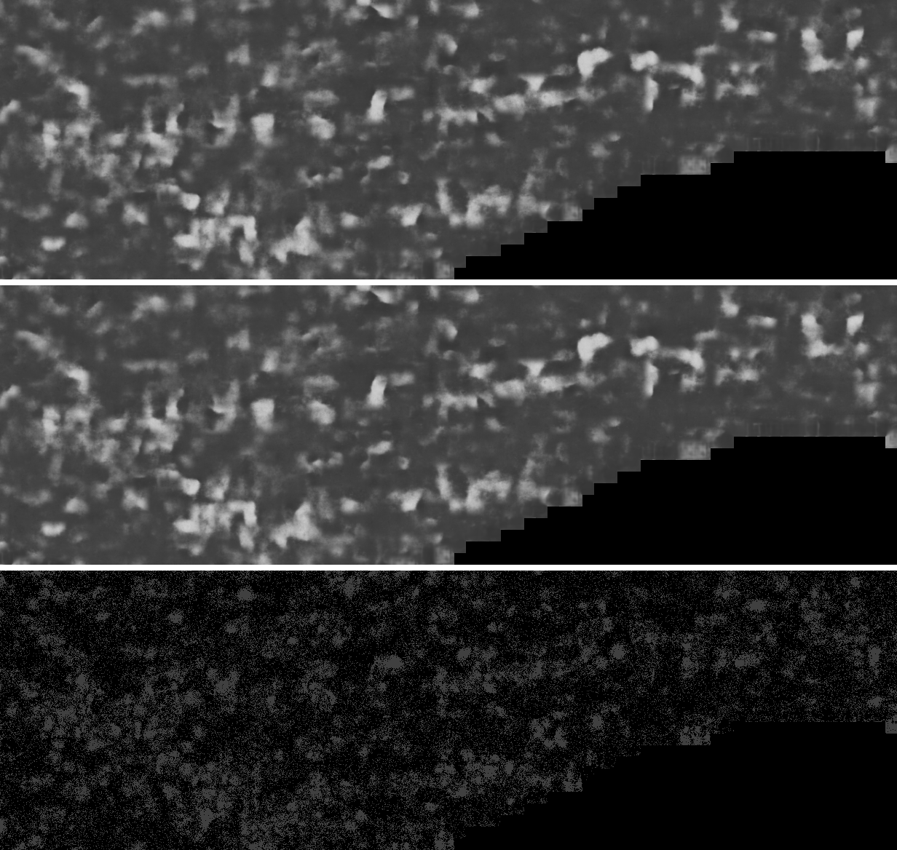

# inkrs

Fast ink detection for the Vesuvius Challenge, written in Rust.

inkrs runs villa's ink models, and a handful of others, entirely on the GPU. It writes the same maps villa's Python code writes, just a lot faster. The volume and the model stay on the GPU, every depth and both directions run in one process, and the TIFFs get written on other threads while the next maps compute.

It runs on NVIDIA GPUs (compute capability 7.5 and up, so T4 / RTX 20 series and newer) and on Apple silicon Macs through Metal.

## How fast

All 18 maps of PHerc. 343's First Letters render (66 × 2560 × 6720, depths −4..4, both directions) with villa's `hybrid_3d2d-seed42`, on one RTX 5090:

| | Time | Faster |
|---|---|---|
| inkrs | **8.50 s** | |
| inksweep fast mode, with `torch.compile` | 64.5 s | **7.57×** |
| villa main with the faster flags from #2428 | 161.7 s | **19.0×** |

The other villa readers get the same kind of speedup, and UFSM, the closest native port, is still well behind:

| Against | Model and input | inkrs | Theirs | Faster |
|---|---|---|---|---|
| villa main with #2428's flags | reader-v2, PHerc. 1447 segment, 10 maps | 3.39 s | 51.4 s | 15.2× |
| inksweep fast mode, compiled | Reader V3, PHerc. 1447 segment, 10 maps | 3.33 s | 52.4 s | 14.5× |
| villa's own `infer`, compiled | `hybrid_3d2d-seed42` through villa's `infer` with the inkrs adapter (not in villa yet), S1, 2 maps | 2.46 s | 14.0 s | 5.68× |
| UFSM | `hybrid_3d2d-seed42`, S1, 1 map | 0.80 s | 1.91 s | 2.35× |
| UFSM | Reader V3, S1, 1 map | 0.78 s | 1.98 s | 2.49× |
| SurgeFok's MPS path, on an M4 Pro Mac | `hybrid_3d2d-seed42`, S1, 1 map | 3.45 s | 19.4 s | 5.62× |

S1 is a 2048 × 2048 crop of the PHerc. 343 render. UFSM is a native C/CUDA port with its own fp16 kernels.

Hecate and v8-in gain less. They're big networks, and inkrs runs their convolutions through cuDNN, the same as PyTorch, so there's less overhead to cut. Hecate in bf16 is 1.70× faster than inksweep, v8-in 1.82× faster than inksweep and 2.38× faster than ink-sdk, and both about 1.2× faster than UFSM. The PHerc. 0306B claim's recipe, mostly v8-in, is 1.68× faster than its own scripts.

The numbers behind these are in [results/](results/), along with how to rerun them.

## Same maps, or it doesn't count

None of the speed matters if the maps are different. For villa's readers I hold inkrs to villa's own bar against villa eager: r ≥ 0.9994, p99.9 and the largest difference at most 4/255, and the same covered pixels. In practice it's a lot closer than that. The 18 maps from the timed 343 run are within 2/255 of villa main's (r ≥ 0.999994), and at d 0, 98.3% of the pixels are identical:



*PHerc. 343 at d 0, reading side, over the band with the published first letters: villa main's map (top), inkrs's (middle), and where they differ (bottom, each 4 × 4 block's largest difference × 64, so one grey level shows as dark grey).*

Hecate gets the same treatment against `hecate.py`'s maps. Every model's checks are in [docs/MODELS.md](docs/MODELS.md).

## Models

- villa's `hybrid_3d2d-seed42`, and the other readers with the same architecture: `reader-v2`, Reader V3, ink_9um seed 43, dense_native, TRACE v3B, and Rectina M1, M2 and M4
- Hecate 9.6 µm
- v8-in (8 µm), and its three A-hn fine-tunes from the PHerc. 0306B claim
- villa's 3D ink U-Net (`ink_3d_dino_guided` v3)

Some of these weights are non-commercial (TRACE v3B, Rectina and A-hn). [docs/MODELS.md](docs/MODELS.md) lists each model's licence.

## Install

The Python package, on Linux x86-64:

```
pip install "inkrs[cu12]"
```

The `cu12` extra pulls in cuDNN 9 and cuBLAS 12 from pip. Leave it off if you already have them, for example from a CUDA 12 PyTorch. For macOS or Windows, build the wheel yourself, see [python/README.md](python/README.md).

Or build the CLI from source. The GPU kernels are committed as PTX, so you don't need the CUDA toolkit:

```
cargo build --release
```

You'll need an NVIDIA driver new enough for CUDA 12 (r525 or later, r570 or later on the RTX 50 series), plus cuDNN 9 and cuBLAS. On a Mac you need Apple silicon and macOS 26, and nothing else.

## Usage

inkrs reads weights from a safetensors export of the checkpoint. You make it once, on the CPU, with villa installed:

```
python -I scripts/export_weights.py ink_9um/hybrid_3d2d-seed42/step-075000.pth weights/
```

Then all 18 maps of a segment in one go:

```
target/release/inkrs sweep RENDER.zarr --ckpt weights/hybrid_3d2d-seed42.safetensors --depths=-4..4 \
  --direction both --stride 64 --out OUT --name SEGMENT
```

From Python:

```python
import inkrs

eng = inkrs.Engine("weights/hybrid_3d2d-seed42.safetensors")
maps = eng.infer("RENDER.zarr", layer_start=25, layer_end=42, direction="both")
sweep = eng.sweep("RENDER.zarr", range(-4, 5))
```

Hecate, v8-in and the 3D U-Net have their own commands (`inkrs hecate`, `inkrs infer` and `inkrs ink3d`). `inkrs --help` lists every option, and [python/API.md](python/API.md) covers the Python API.

## Where it's not faster

- **No GPU.** There's no CPU path.
- **The very first run.** inkrs compiles its GPU code on first use, so UFSM, which ships precompiled kernels, wins that one run: 1.87 s against 2.08 s for a `hybrid_3d2d-seed42` map, and 17.7 s against 27.0 s for Hecate.
- **Hecate in fp32.** UFSM's fp16 Hecate takes 17.7 s, inkrs's fp32 takes 30.9 s. Use `--fast` (bf16), which keeps the ink: on the labelled segments I scored, its AUC moved by at most 0.0006 ([docs/FAST.md](docs/FAST.md)).
- **Training.** inkrs only does inference.

A few other limits worth knowing:

- Inputs have to be uint8 zarr v2, and the whole volume has to fit on the GPU in under 4 GiB.
- Only the Hann blend and villa's unpadded tile phase.
- The full equivalence checks ran on an RTX 5090. A T4, an A10, an A100, an L4, an RTX 4090 and an M4 Pro passed the per-map checks ([results/README.md](results/README.md)). Other GPUs should work but haven't been tried.
- The Windows build has never run on actual Windows. It's cross-built on Linux and its tests pass under Wine.
- The Metal backend doesn't do the 3D U-Net or test-time augmentation.

## Other runners

| | inkrs | villa | inksweep | UFSM | ink-sdk |
|---|---|---|---|---|---|
| villa readers, speed | fastest | 19× slower | 7.6× to 14.5× slower | 2.4× slower | runs villa, so about villa's speed |
| Matches villa's maps | ✅ | the reference | ✅ | ✅ | ✅ |
| Hecate | ✅ | ❌ | ✅ | ✅ fp16 only | ✅ |
| v8-in and A-hn | ✅ | ❌ | v8-in only | ✅, but its A-hn misses the 0306B recipe | ✅ |
| Apple silicon | ✅ Metal | ⚠️ PyTorch MPS, slower | ❌ | ❌ | ⚠️ PyTorch MPS, slower, not tested by its authors |
| Install | `pip` | `pip` | `pip` | build from source | `git clone`, then `pip` |
| Licence | MIT or Apache-2.0 | MIT | MIT | none | MIT |
| Training | ❌ | ✅ | ❌ | ✅ its own models | ❌ |
| Renders segments from a mesh | ❌ | ✅ VC3D | ✅ | ✅ its own surfaces | ✅ |

## More

- [docs/WRITEUP.md](docs/WRITEUP.md): why I built this and how it got fast
- [docs/MODELS.md](docs/MODELS.md): every model, its licence and its checks
- [docs/FAST.md](docs/FAST.md): the faster settings and what they cost in accuracy
- [results/README.md](results/README.md): what each results file holds, and how to rerun the main checks and timings

## Credits

inkrs reimplements other people's work and is checked against it. villa wrote the ink models' architecture, `hybrid_3d2d-seed42`, the 3D ink U-Net, and the inference code inkrs matches. Domenico Russo trained reader-v2 and Reader V3. The Vesuvius Challenge released Hecate 9.6 µm and `hecate.py`. Youssef Nader trained v8-in, and Prodigle its A-hn fine-tunes for PHerc. 0306B. J. S. Gill and N. N. Tran trained TRACE v3B, and G. Pellerano the Rectina models. gomyway published the reader-v2 and Hecate maps I checked against. UFSM (SuperOptimizer), ink-sdk (LimeGS), inksweep and SurgeFok's MPS path are the other public runners I compared with.

## Licence

Either the Apache License, Version 2.0 ([LICENSE-APACHE](LICENSE-APACHE)) or the MIT licence ([LICENSE-MIT](LICENSE-MIT)), at your option. Unless you say otherwise, any contribution you submit is dual licensed the same way.

Third-party material and its licences are listed in `THIRD_PARTY_NOTICES`.
